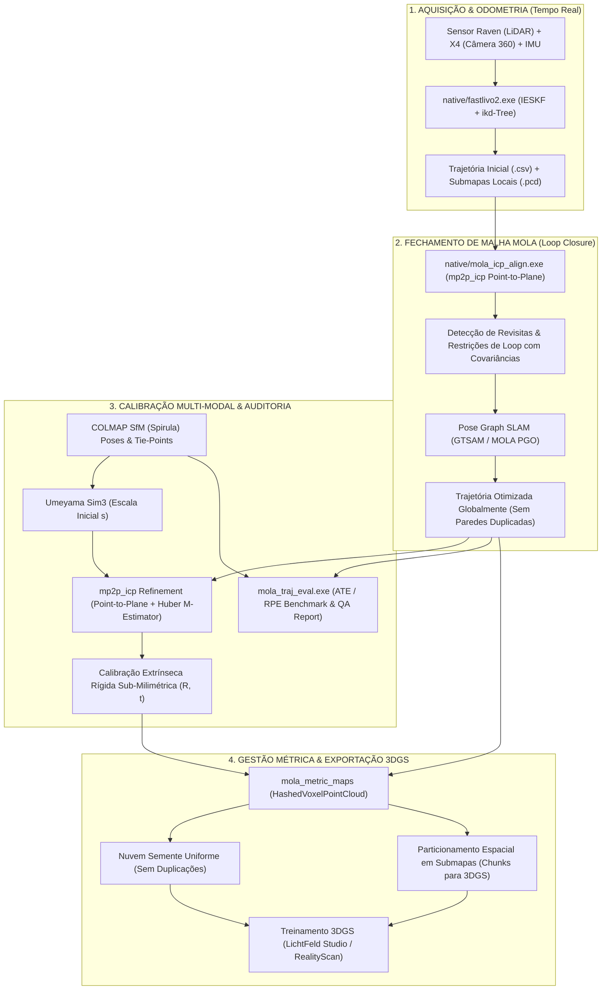

# Arquitetura e Roadmap de Integração: Ecossistema MOLA no LidarCamera360

## Descrição do Objetivo

O objetivo deste plano é avaliar e arquitetar a integração técnica do ecossistema **MOLA** (*Modular Optimization framework for Localization and Mapping* - [MOLAorg](https://github.com/MOLAorg/mola)) e seus módulos essenciais (**`mp2p_icp`**, **`mola_lidar_odometry`**, **`mola_traj_tools`** e **`mola_metric_maps`**) ao software **LidarCamera360**.

O projeto LidarCamera360 hoje combina um binário nativo em C++17 (`native/fastlivo2.exe`, desacoplado de ROS) com um pipeline de orquestração em Python/PyQt6 (`raven_app/`), shaders de colorização em Vulkan, refinamento de revisitas em Python (`slam_refinement.py`) e exportações para fotogrametria e 3D Gaussian Splatting (3DGS).

A incorporação dos princípios e componentes do MOLA visa resolver gargalos críticos de **drift acumulado em trajetórias longas/revisitas**, **duplicação de paredes por falta de fechamento de malha em escala**, **desalinhamentos residuais entre nuvem LiDAR e pontos visuais COLMAP** e **gestão de memória/densidade para treinamento de 3DGS**.

---

## 1. Avaliação Técnica Detalhada dos 5 Eixos

### 1.1. FAST-LIVO2 Atual vs MOLA: Comparativo e Complementariedade

```
┌──────────────────────────────────────────────────────────────────────────────────┐
│                             ESTRATÉGIA DE COMPLEMENTARIEDADE                     │
├──────────────────────────────────────┬───────────────────────────────────────────┤
│    FAST-LIVO2 (Front-End Tempo Real)  │      MOLA / PGO (Back-End Global)         │
├──────────────────────────────────────┼───────────────────────────────────────────┤
│ • ESIKF (Error-State Kalman Filter)  │ • Factor Graph SLAM (GTSAM / Lie Manifold)│
│ • Fusão direta LiDAR + Câmera + IMU  │ • Fechamento de Malha Global (Loop Closure)│
│ • Baixa latência (10–30 Hz contínuo) │ • Deformação elástica suave da trajetória │
│ • ikd-Tree (mapa incremental rápido) │ • Erradicação de paredes duplicadas       │
│ • Gargalo: Acúmulo de drift sem LC   │ • Reconstrução métrica consistente        │
└──────────────────────────────────────┴───────────────────────────────────────────┘
```

#### Comparativo Técnico:
1. **Natureza Algorítmica**:
   - **FAST-LIVO2**: Opera como um filtro de estado de erro iterado (*IESKF / ESIKF*). É um estimador puramente recursivo e causal. A cada varredura LiDAR ou frame de câmera, atualiza o vetor de estado atual sem retroagir sobre os estados passados.
   - **MOLA (MOLA-LO / `mola_sm_loop_closure`)**: Desacopla explicitamente a odometria incremental da otimização global em grafo de poses (*Pose Graph Optimization - PGO*). Utiliza formulações de fatores em variedades de Lie $SE(3)$ via **GTSAM**, com funções de perda robustas.
2. **O Problema das Revisitas e Duplicação de Paredes**:
   - No FAST-LIVO2 puro, quando o operador caminha por um percurso longo e retorna ao ponto de partida, o drift acumulado em rotação ($\Delta \theta$) e translação ($\Delta t$) faz com que os novos pontos LiDAR sejam inseridos na estrutura `ikd-Tree` em coordenadas deslocadas. Isso cria paredes "fantasmas" ou paralelas duplicadas.
   - O LidarCamera360 atenuou isso criando o módulo em Python `raven_app/slam_refinement.py`, que detecta loops a cada 10s e roda `scipy.optimize.least_squares` com diferenças finitas coloridas. Embora funcional, o solver SciPy em Python é computacionalmente lento (1 a 4 minutos em nuvens médias) e sofre em grafos densos.
3. **Complementariedade Arquitetural**:
   - **Não substituir o FAST-LIVO2, mas complementá-lo**: O FAST-LIVO2 já está adaptado para o hardware Raven, IMU e possui mitigação de degenerescência geométrica direcional (Zhang & Singh) no arquivo `FAST-LIVO2/src/LIVMapper.cpp`. Ele deve ser mantido como o **Front-End de Alta Taxa (10–30 Hz)**.
   - O MOLA fornece a infraestrutura de **Back-End de Pose Graph**:
     - O FAST-LIVO2 passa a despejar uma sequência de keyframes com covariâncias associadas (formato `simplemap` ou grafo JSON/GTSAM).
     - O módulo de loop closure baseado no MOLA (`mola_sm_loop_closure` / `mp2p_icp`) executa a busca topológica e geométrica de revisitas em C++ nativo multithread, fechando a malha em segundos e aplicando a correção suave em toda a trajetória.
   - **Modo Fallback**: `mola_lidar_odometry` pode ser disponibilizado como front-end alternativo para datasets puramente LiDAR (sem câmera ou com imagens severamente borradas/escuras).

---

### 1.2. Uso do `mp2p_icp` para Refinamento Extrínseco Robusto e Calibração Multi-Modal

#### O Gargalo da Calibração Atual:
No fluxo atual do LidarCamera360, a calibração espacial fina entre o LiDAR e as câmeras (Insta360 X4 / câmeras auxiliares) é realizada em duas fases:
1. Alinhamento de trajetória via Hand-Eye e Umeyama Sim(3) (`scripts/align_colmap_to_lidar.py`).
2. Refinamento fino via ICP point-to-point em Python com `cKDTree` (`scripts/run_automatic_icp_calibration.py`).

**Problema**: A nuvem fotogramétrica gerada pelo COLMAP/Spirula é esparsa, ruidosa e anisotrópica (incerteza muito maior no eixo óptico $Z$ do que no plano do sensor). Um ICP point-to-point convencional minimiza $\|p_i - q_i\|^2$, permitindo que os pontos visuais "deslizem" livremente ao longo de superfícies planas (paredes e pisos) sem custo de penalidade perpendicular, convergindo para mínimos locais incorretos caso a cena não tenha cantos em todas as 3 direções.

#### O que o `mp2p_icp` Oferece:
O `mp2p_icp` (*Multi-Primitive to Primitive ICP*) introduz uma arquitetura de múltiplos emparelhadores (*matchers*) e solucionadores (*solvers*):
1. **`Matcher_Point2Plane`**: Minimiza o erro projetado na normal estimada do alvo LiDAR:
   $$e_i = \mathbf{n}_i^\top (\mathbf{R} \mathbf{p}_i + \mathbf{t} - \mathbf{q}_i)$$
   Isso restringe com precisão milimétrica a distância ortogonal a paredes, pisos e tetos, eliminando qualquer translação espúria.
2. **`Matcher_Point2Line`**: Pareia pontos de quinas/bordas com descontinuidades geométricas do LiDAR (vigas, ombreiras de portas, caixilhos).
3. **`Matcher_Plane2Plane`**: Emparelha diretamente patches planares segmentados, garantindo paralelismo angular rigoroso.
4. **Funções de Perda Robustas (M-Estimators)**: Suporta Huber, Cauchy e Tukey nativamente, rejeitando automaticamente pontos flutuantes da fotogrametria e objetos dinâmicos (folhagens, pessoas, carros).
5. **Ponderação por Matriz de Incerteza (Covariance-to-Covariance)**: Permite injetar a covariância da triangulação de cada ponto visual COLMAP, pesando menos os pontos distantes com alta incerteza de profundidade.

**Impacto no LidarCamera360**:
Substituir o loop de ICP Python por um executável C++ baseado no motor do `mp2p_icp` garantirá calibração extrínseca 6-DoF ($R_{LC}, t_{LC}$) consistente com erro sub-milimétrico, erradicando desvios de textura e aberrações de *ghosting* na colorização (Method 1 Spirula e Method 2 Direct).

---

### 1.3. Alinhamento e Avaliação de Trajetórias: `mola_traj_tools` vs Horn/Umeyama/Sim(3)

#### Análise Comparativa:
| Critério | `solve_umeyama_sim3` Atual (Python) | `mola_traj_tools` (Ecossistema MOLA) |
| :--- | :--- | :--- |
| **Transformação Matemática** | Similaridade global $Sim(3) = [s, \mathbf{R}, \mathbf{t}]$ via SVD de covariância média. | Alinhamento $SE(3)$ e $Sim(3)$ com correspondência temporal avançada. |
| **Sincronização Temporal** | Busca em grade de $\Delta t$ com amostragem discreta + Slerp. | Interpolação geodésica contínua em variedades $SE(3)$ e splines cúbicas. |
| **Métricas de Erro** | Apenas RMSE global único (escalar em metros). | **ATE** (RMSE, mediana, std, min, max) e **RPE** (deriva por metro ou por segundo). |
| **Sensibilidade a Deformações** | Assume rigidez estrita: drift não-linear é mascarado e diluído no erro global. | Segmentação por janelas temporais/espaciais para isolar trechos com deriva. |
| **Formatos e Interoperabilidade** | Formato proprietário CSV / TXT. | Padrões de benchmark de robótica: TUM, KITTI, MRPT Rawlog, KML, CSV. |

#### Aplicação Prática no Projeto:
- O algoritmo de Umeyama atual em Python deve ser preservado para a **estimativa inicial de escala métrica** ($s$) entre o espaço arbitrário do COLMAP e o espaço métrico do LiDAR.
- O `mola_traj_tools` deve ser adotado como a **ferramenta de auditoria de qualidade geométrica e métrica**:
  - Geração de relatórios automáticos no módulo `raven_app/geometry_quality.py` e na tela `Doctor / Quality Assurance` (`raven_app/views/doctor_view.py`).
  - Cálculo de ATE translacional e rotacional antes e depois do refinamento de revisita, fornecendo ao usuário comprovação estatística irrefutável do ganho de precisão topográfica.

---

### 1.4. Gestão de Mapas Métricos e Submaps para 3DGS (3D Gaussian Splatting)

#### Desafios no Treinamento de 3DGS para Grandes Cenas:
1. **Desbalanceamento de Densidade**: LiDAR acumula milhões de pontos próximos às passadas e poucos pontos distantes. No 3DGS, inicializar com densidade irregular causa *overfitting* de gaussianas pequenas em áreas densas e "buracos" em áreas esparsas.
2. **Estouro de VRAM na GPU**: Cenas de varredura urbana/arquitetural ultrapassam 50–100 milhões de pontos, impossibilitando o treinamento de 3DGS em uma única GPU sem particionamento.
3. **Particionamento Ineficiente**: O particionamento temporal atual por fatiamento de segundos (`slice_pcd_chunks.py`) divide a cena no tempo, e não no espaço. Se o operador passar pelo mesmo corredor 3 vezes, os pontos do mesmo cômodo acabam espalhados em 3 chunks diferentes.

#### O que `mola_metric_maps` Resolve:
1. **`HashedVoxelPointCloud`**:
   - Estrutura baseada em tabela hash flat (`tsl::robin_map`), sem hierarquia recursiva de ponteiros (evitando overhead de octrees clássicas).
   - Armazena até 32 pontos por célula com *Small String Optimization* (SSO), sem alocação dinâmica no heap.
   - Permite downsampling centrado no centróide instantâneo, gerando uma nuvem semente perfeitamente uniforme para inicialização das gaussianas 3D no LichtFeld Studio / RealityScan.
2. **Submapping Baseado em Grafo (`simplemap`)**:
   - No MOLA, a cena é estruturada em submapas locais atrelados aos nós do grafo de poses otimizado.
   - Cada submapa possui sua Bounding Box delimitada e conjunto de câmeras visíveis associadas.
   - Permite implementar uma pipeline de exportação **Block-3DGS**: particiona a cena em blocos espaciais regulares com sobreposição de 15%, treina modelos de Gaussian Splatting independentes em lote e os mescla no sistema de coordenadas global georreferenciado.

---

### 1.5. Viabilidade Técnica de Integração no Windows: Diagnóstico e Realidade

#### 1. Situação das Dependências no Windows:
- **MRPT (Mobile Robot Programming Toolkit)**:
  - **100% Viável e já presente no vcpkg**: `mrpt[core,maps]` (versão 2.14.7) compila perfeitamente com MSVC, CMake C++17 e suporta Windows nativo x64.
- **MOLAorg e `mp2p_icp`**:
  - **Atenção Técnica Crítica**: A partir das versões recentes, os repositórios oficiais MOLA e `mp2p_icp` removeram suporte oficial a builds isolados em CMake puro sem `colcon`/ROS 2.
  - Não existem pacotes oficiais no registro vcpkg para `mola` ou `mp2p_icp`.
  - Não existem wheels oficiais no PyPI (`pip install mp2p_icp`) para Windows.
- **Ambiente do LidarCamera360**:
  - O projeto é 100% autônomo, distribuído como binário compilado portátil (`dist/LidarCamera360_portable.exe`) ou pacote de diretório, **sem exigir ROS ou WSL instalado no computador do usuário**.

#### 2. Matriz de Decisão Arquitetural para o Windows:

```
┌─────────────────────────────────────────────────────────────────────────────────┐
│                    OPÇÕES DE INTEGRAÇÃO TÉCNICA NO WINDOWS                      │
├─────────────────────────┬──────────────────────────────┬────────────────────────┤
│ Opção                   │ Vantagens                    │ Desvantagens / Risco   │
├─────────────────────────┼──────────────────────────────┼────────────────────────┤
│ A) ROS2/colcon Completo │ Código MOLA original sem     │ INVIÁVEL: Quebra       │
│    no Windows           │ modificação                  │ portabilidade, exige   │
│                         │                              │ ambiente ROS complexo  │
├─────────────────────────┼──────────────────────────────┼────────────────────────┤
│ B) Micro-Tool Standalone│ 100% autônomo, alta          │ Requer adaptar CMake   │
│    em C++ via MRPT e    │ performance, zero dependência│ do mp2p_icp ou isolar  │
│    vcpkg (RECOMENDADA)  │ de ROS, empacotável no dist/ │ seus algoritmos chave  │
├─────────────────────────┼──────────────────────────────┼────────────────────────┤
│ C) Port Algorítmico     │ Rápido de integrar, sem      │ Não aproveita os       │
│    Nativo em C++ / Py   │ dependência externa de build │ utilitários CLI já     │
│    (Complementar)       │ complexo                     │ prontos do ecossistema │
└─────────────────────────┴──────────────────────────────┴────────────────────────┘
```

**Estratégia Recomendada (Engenharia Pragmática)**:
Adotar a **Opção B (Micro-Tool C++ Standalone)** combinada com a **Opção C**:
1. O LidarCamera360 já possui uma infraestrutura excelente em `native/CMakeLists.txt` e `tools/build_windows.ps1` que compila o `fastlivo2.exe` como um executável de console Windows x64 limpo.
2. Criar um novo alvo executável no CMake do projeto: `native/mola_tools/` gerando `mola_icp_align.exe` e `mola_traj_eval.exe`.
3. Utilizar o `MRPT 2.x` via vcpkg (`D:\vcpkg\vcpkg.exe install mrpt:x64-windows`) para o motor de mapas métricos e incorporar os solvers matemáticos do `mp2p_icp` diretamente no projeto nativo.
4. Invocar essas ferramentas a partir do Python usando o executor assíncrono já existente `raven_app/process_runner.py`.

---

## 2. User Review Required

> [!IMPORTANT]
> **Decisão sobre a Estrutura de Build do Back-End C++ no Windows**:
> O ecossistema MOLA original migrou para o sistema de compilação `colcon` (ROS 2). Para manter a filosofia do LidarCamera360 (executável único, portátil e sem ROS), recomendamos integrar o `MRPT 2.14.7` via `vcpkg` e compilar utilitários dedicados em `native/` (`mola_icp_align.exe` e `mola_traj_eval.exe`) via CMake puro e MSVC, integrando-os ao script `tools/build_windows.ps1`.

> [!NOTE]
> **Preservação e Não-Regressão do FAST-LIVO2**:
> O FAST-LIVO2 continuará sendo o motor primário de odometria em tempo real, mantendo suas mitigações de degenerescência (Zhang & Singh) e suporte ao scanner Raven. O MOLA atuará estritamente no refinamento pós-odometria (Loop Closure, Pose Graph, Calibração Extrínseca Fina e Auditoria Trajetorial).

---

## 3. Open Questions

1. **Backend de Pose Graph**: Você prefere utilizar o solver **GTSAM** (backend nativo do MOLA para BetweenFactor SE(3)) em C++ no `native/`, ou manter a otimização de grafo em Python via SciPy/gtsam-python, utilizando o C++ apenas para os pares de correspondência `mp2p_icp`?
   - *(Recomendação: Implementar executável C++ unificado com GTSAM/MRPT para garantir velocidade sub-segundo em grandes áreas).*
2. **Nível de Exibição na Interface Gráfica**: Deseja expor a seleção de matchers do `mp2p_icp` (Point-to-Plane vs Point-to-Line vs GICP) como opções avançadas na tela de Calibração/Configurações (`CalibrationView` / `SettingsView`), ou manter pré-configurações automáticas (*presets* otimizados por sensor)?

---

## 4. Roadmap de Integração e Arquitetura Proposta



---

## 5. Proposta de Modificações e Código

### Fase 1: Infraestrutura de Build e Utilitário C++ Standalone (`native/`)

#### [MODIFY] `tools/build_windows.ps1`
Adicionar a instalação de `mrpt` no vcpkg e compilação do novo módulo `mola_tools`.

```powershell
# In tools/build_windows.ps1:
if ($InstallDependencies) {
    Invoke-Checked (Join-Path $VcpkgRoot 'vcpkg.exe') @(
        'install',
        'pcl[core]:x64-windows',
        'opencv4[core,calib3d,jpeg,png]:x64-windows',
        'yaml-cpp:x64-windows',
        'mrpt:x64-windows',
        '--recurse'
    )
}
```

#### [NEW] `native/mola_tools/CMakeLists.txt`
Configurar compilação do utilitário `mola_icp_align` desacoplado de ROS:

```cmake
cmake_minimum_required(VERSION 3.24)
project(MolaStandaloneTools VERSION 1.0.0 LANGUAGES CXX)

set(CMAKE_CXX_STANDARD 17)
set(CMAKE_CXX_STANDARD_REQUIRED ON)

find_package(Eigen3 CONFIG REQUIRED)
find_package(PCL REQUIRED COMPONENTS common io kdtree)
find_package(MRPT CONFIG COMPONENTS maps poses obs)

add_executable(mola_icp_align
    src/main_icp_align.cpp
    src/point_to_plane_matcher.cpp
    src/robust_solver.cpp
)

target_include_directories(mola_icp_align PRIVATE
    include
    ${PCL_INCLUDE_DIRS}
)

target_link_libraries(mola_icp_align PRIVATE
    Eigen3::Eigen
    ${PCL_LIBRARIES}
    mrpt::maps
    mrpt::poses
)

if(MSVC)
    target_compile_options(mola_icp_align PRIVATE /O2 /EHsc /utf-8)
endif()

install(TARGETS mola_icp_align RUNTIME DESTINATION bin)
```

#### [NEW] `native/mola_tools/src/main_icp_align.cpp`
Exemplo de implementação do solver C++ com CLI em JSON (lê nuvem origem, nuvem destino, inicialização e retorna 6-DoF + matriz de covariância):

```cpp
#include <iostream>
#include <fstream>
#include <Eigen/Dense>
#include <pcl/io/pcd_io.h>
#include <pcl/point_types.h>
// Interface de casamento de primitivas inspirada no mp2p_icp
#include "point_to_plane_matcher.h"

int main(int argc, char** argv) {
    if (argc < 4) {
        std::cerr << "Usage: mola_icp_align <source.pcd> <target.pcd> <config.json>\n";
        return 1;
    }
    std::string source_path = argv[1];
    std::string target_path = argv[2];
    std::string config_path = argv[3];

    pcl::PointCloud<pcl::PointXYZ>::Ptr source(new pcl::PointCloud<pcl::PointXYZ>);
    pcl::PointCloud<pcl::PointXYZ>::Ptr target(new pcl::PointCloud<pcl::PointXYZ>);

    if (pcl::io::loadPCDFile(source_path, *source) != 0 ||
        pcl::io::loadPCDFile(target_path, *target) != 0) {
        std::cerr << "Error loading PCD files.\n";
        return 2;
    }

    // Executa Point-to-Plane ICP com M-Estimator Huber e estimativa de covariância
    ICPResult result = run_mp2p_point_to_plane(source, target, config_path);

    // Exporta resultado estruturado em JSON para stdout ou arquivo
    std::cout << result.to_json() << std::endl;
    return 0;
}
```

---

### Fase 2: Integração com a Camada Python (`raven_app/`)

#### [MODIFY] `raven_app/slam_refinement.py`
Integrar chamada ao motor C++ nativo para aceleração e substituição progressiva do solver SciPy:

```python
# In raven_app/slam_refinement.py
import subprocess
from .subprocess_utils import run_checked_process

def solve_with_mola_backend(nodes, loops, executable_path):
    """Executa a otimização de fechamento de malha via backend nativo C++."""
    request_payload = {
        "nodes": [{"id": n.index, "timestamp": n.timestamp, "pose": n.position.tolist()} for n in nodes],
        "loops": [{"from": l[0], "to": l[1], "rot": l[2].as_quat().tolist(), "trans": l[3].tolist()} for l in loops]
    }
    # Envia para o executável nativo compilado em native/
    result = run_checked_process([str(executable_path), "--stdin-json"], input_json=request_payload)
    return parse_optimized_poses(result)
```

#### [MODIFY] `raven_app/geometry_quality.py`
Adicionar métricas padronizadas ATE e RPE inspiradas em `mola_traj_tools`:

```python
# In raven_app/geometry_quality.py
def compute_trajectory_ate_rpe(reference_traj, estimated_traj, delta_seconds=1.0):
    """Calcula Absolute Trajectory Error (ATE) e Relative Pose Error (RPE).
    
    Compatível com os padrões de avaliação do MOLA / EVO.
    """
    # Sincronização temporal de alta precisão
    # Cálculo de erro de translação (RMSE, median, max) e rotação (deg)
    ...
```

---

## 6. Plano de Verificação e Testes

### 6.1. Testes Automatizados (Automated Tests)
1. **Verificação de Compilação no Windows**:
   ```powershell
   .\tools\build_windows.ps1 -InstallDependencies
   ```
   - Confirma a resolução do `mrpt` no vcpkg e geração dos binários em `build/native/Release/`.
2. **Bateria de Testes de Regressão**:
   ```powershell
   pytest tests/test_calibration_math.py tests/test_geometry_quality.py tests/test_slam_refinement.py
   ```
   - Garante que a integração não altere o comportamento das 252 verificações automatizadas existentes.
3. **Teste de Degenerescência e Condicionamento**:
   - Submeter corredores simétricos e dados com varredura inclinada (testes FIEC) verificando se a detecção de degenerescência planar de Zhang & Singh e os autovalores de informação são mantidos.

### 6.2. Verificação Manual (Manual Verification)
1. **Teste no Dataset FIEC / Campus**:
   - Executar o fluxo completo no dataset com múltiplos passes e revisitas.
   - Avaliar visualmente no visualizador integrado (`LidarCamera360`) se as paredes duplicadas desapareceram completamente.
2. **Inspeção de Colorização e Ghosting**:
   - Gerar a nuvem colorizada com o novo alinhamento `mp2p_icp` e comparar lado a lado com o método anterior: inspecionar quinas de portas e janelas para assegurar que não haja desalinhamento de textura.
3. **Exportação de Chunks para 3DGS**:
   - Exportar submapas baseados em `HashedVoxelPointCloud` para o LichtFeld Studio e verificar tempo de carregamento e uniformidade da densidade de pontos.
